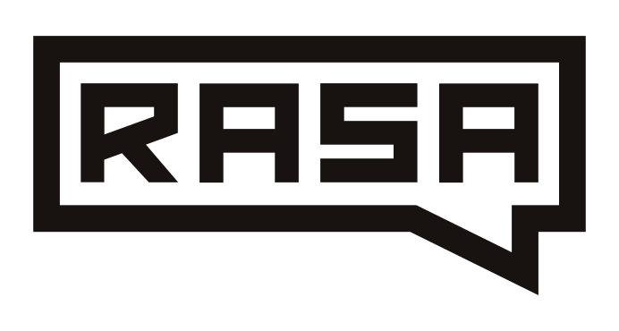

<div align="center">

<picture>
  <source media="(prefers-color-scheme: dark)" srcset="./.github/assets/rasa-logo-horizontal-cream.svg">
  
</picture>

# Rasa Quickstart

### A Rasa Mantle agent, in one command.

Bootstrap a fresh **[Rasa Mantle](https://mantle.rasa.com)** agent — Rasa's
LLM-native engine — with a skills scaffold, a trained model, and coding-agent
skills, MCP tools, and docs wired into your editor, in a single command.
No cloning, no setup steps.

<br>

<picture><source media="(prefers-color-scheme: dark)" srcset="https://img.shields.io/badge/Docs-FAF6F0?style=for-the-badge&logo=readthedocs&logoColor=181210"><a href="https://mantle.rasa.com"></a></picture>
<picture><source media="(prefers-color-scheme: dark)" srcset="https://img.shields.io/badge/Developer%20Edition-Free-E85A91?style=for-the-badge&labelColor=FAF6F0"><a href="https://rasa.com/rasa-pro-developer-edition-license-key-request"></a></picture>
<picture><source media="(prefers-color-scheme: dark)" srcset="https://img.shields.io/badge/Learning-FAF6F0?style=for-the-badge&logo=bookstack&logoColor=181210"><a href="https://learning.rasa.com/rasa-pro/"></a></picture>
<picture><source media="(prefers-color-scheme: dark)" srcset="https://img.shields.io/badge/Discord-FAF6F0?style=for-the-badge&logo=discord&logoColor=181210"><a href="https://discord.gg/rwhHg9PZBv"></a></picture>

</div>

---

## ⚡ Get started

### 1. Grab your two keys

- 🔑 **Rasa license** — free with the [**Rasa Developer Edition**](https://rasa.com/rasa-pro-developer-edition-license-key-request). Sign up and you'll get a license key.
- 🤖 **LLM API key** — an [**OpenAI API key**](https://platform.openai.com/api-keys) by default (Rasa supports other providers too).

### 2. Run the bootstrap

**macOS / Linux**

```bash
curl -fsSL https://raw.githubusercontent.com/rasa-customers/rasa-quickstart/main/install.sh | bash
```

**Windows (PowerShell)**

```powershell
irm https://raw.githubusercontent.com/rasa-customers/rasa-quickstart/main/install.ps1 | iex
```

This installs [`uv`](https://docs.astral.sh/uv/), downloads the project into a new
`rasa-quickstart/` folder, and sets up the virtual environment. With your keys
already in place it also installs the Mantle coding-agent skills, registers the
Rasa MCP server, downloads the Mantle docs, and trains an initial model; without
them, it pauses and tells you what to grab.

### 3. Add your keys to `.env`

```bash
cd rasa-quickstart
```

Open `.env` and paste in the two keys from step 1:

```bash
RASA_LICENSE=your-license-key
OPENAI_API_KEY=your-openai-key
```

### 4. Finish setup and talk to your agent

```bash
make setup      # picks up your keys: installs skills + docs, trains the first model
make inspect
```

This opens the Inspector in your browser, where you can chat with your agent
and watch its reasoning live. Try *"Show me my recent transactions."*

---

## 🎛️ Options

Pass a target directory and/or flags. On macOS/Linux, append them after `-s --`:

```bash
curl -fsSL https://raw.githubusercontent.com/rasa-customers/rasa-quickstart/main/install.sh \
  | bash -s -- --ides claude,cursor --provider openai my-agent
```

On Windows, run the downloaded script with arguments:

```powershell
& ([scriptblock]::Create((irm https://raw.githubusercontent.com/rasa-customers/rasa-quickstart/main/install.ps1))) `
  -Ides claude,cursor -Provider openai my-agent
```

| Flag | Values | Default |
|---|---|---|
| `--ides` | `claude`, `cursor`, `vscode`, `jetbrains` (comma-separated) | auto-detected, then prompted |
| `--provider` | `openai`, `anthropic` | `openai` |
| `--yes` | accept detected defaults, no prompts | off |
| `--skip-train` | skip the initial model training | off |
| *(positional)* | target directory to create | `rasa-quickstart` |

---

## 📦 What you'll get

The bootstrap delivers the project in [`template/`](template/):

```
agent.yml           identity, persona, global rules
integrations.yml    LLM model groups, channels, optional MCP servers / tracing
skills/             one folder per skill: skill.md + memory.yml + tools.py
AGENTS.md           context for your coding agent (Mantle, not CALM)
Makefile            setup / run / inspect / train / ...
scripts/setup.py    one-shot provisioning
pyproject.toml      pinned rasa-pro dependency (3.20.x, uv-managed)
.env.example        secrets template (copy to .env)
```

See [`template/README.md`](template/README.md) for the day-to-day building guide.

---

## 🧰 What you'll need

- 🔑 A **free [Rasa Developer Edition license](https://rasa.com/rasa-pro-developer-edition-license-key-request)** → `RASA_LICENSE` in `.env`
- 🤖 An **OpenAI API key** (the default provider — Rasa supports other LLMs too) → `OPENAI_API_KEY` in `.env`
- ⚡ [**`uv`**](https://docs.astral.sh/uv/) — installed automatically by the bootstrap; it also handles the right Python version

---

## 🗂️ Already have the repo?

If you cloned this repo instead of using the bootstrap, the project lives in `template/`:

```bash
cd template
cp .env.example .env    # fill in RASA_LICENSE + your LLM key
make setup
make inspect
```

---

## 🏗️ Repository layout

This repo is a source/template — most of it never lands on your machine:

- **`template/`** — the delivered project. The bootstrap copies *only* this directory, then starts a fresh git history.
- **`install.sh` / `install.ps1`** — the bootstrap, served over HTTPS and run directly (never copied).
- **`tests/`, `.github/`, `scripts/maintenance/`** — CI and maintenance tooling for this repo, not part of your project.

**Contributing:** run the checks with
`uv run --with pytest --with ruamel.yaml python -m pytest tests/`.
The pinned Rasa version tracks the latest release over time; the committed scaffold in `template/` is kept in sync with `rasa init --engine mantle` by automation.

**License:** this repo (scaffold, scripts, docs) is [Apache-2.0](LICENSE). Rasa Pro itself is not part of this repo — the setup installs it from PyPI, governed by the [Developer Terms](https://rasa.com/developer-terms) and your license key.

---

<div align="center">

### Ready to build something real?

<a href="https://rasa.com/connect-with-rasa"></a>
&nbsp;&nbsp;
<picture><source media="(prefers-color-scheme: dark)" srcset="https://img.shields.io/badge/%F0%9F%93%96%20Read%20the%20docs-FAF6F0?style=for-the-badge"><a href="https://mantle.rasa.com"></a></picture>

<sub>Built with ❤️ by the Rasa team · <a href="https://rasa.com/">rasa.com</a> · <a href="https://discord.gg/rwhHg9PZBv">Discord community</a></sub>

</div>
